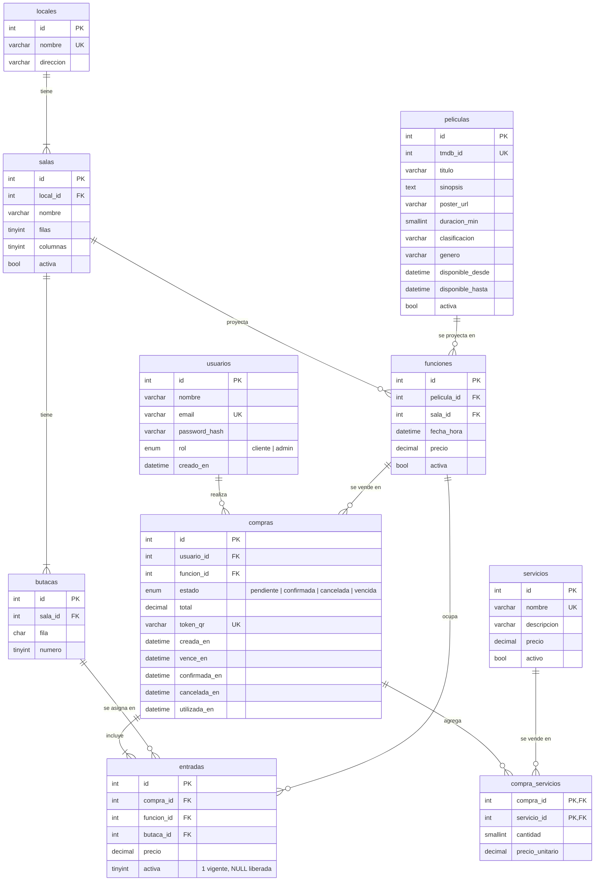

# Modelo de datos

Base MySQL `cine_paradiso`. El script de creación es [`src/backend/sql/schema.sql`](../src/backend/sql/schema.sql) y la carga inicial [`src/backend/sql/seed.sql`](../src/backend/sql/seed.sql).

Convenciones:

- Fechas y horas siempre en **un único campo `DATETIME`** (nunca fecha y hora separadas).
- Consultas con SQL explícito y parametrizado, sin ORM.
- Bajas **lógicas** (`activa` / `activo`) para no perder el historial de compras.

## Diagrama entidad-relación

## Tablas

| Tabla | Para qué sirve |
|---|---|
| `usuarios` | Clientes y administradores. Contraseña con hash; email único. |
| `locales` | Los 3 centros de Cine Paradiso. |
| `salas` | Salas de cada local. La capacidad es `filas × columnas`. |
| `butacas` | Asientos de cada sala, identificados por fila (A, B, C…) y número. |
| `peliculas` | Catálogo importado de TMDB, con el período en que está disponible. |
| `funciones` | Una película en una sala, en una fecha y hora (`fecha_hora`), con su precio. |
| `servicios` | Comida, bebidas, estacionamiento, VIP… Disponibles para todas las salas. |
| `compras` | Compra de un cliente para una función: estado, total, token del QR y fechas de cada etapa. |
| `entradas` | Cada butaca vendida dentro de una compra. |
| `compra_servicios` | Servicios agregados a una compra, con cantidad y precio del momento. |

## Cómo se resuelven las reglas del negocio

| Regla | Solución en la base |
|---|---|
| Una butaca no se vende dos veces en la misma función | `UNIQUE (funcion_id, butaca_id, activa)` en `entradas`. Mientras la compra está vigente `activa = 1`; al cancelar o vencer pasa a `NULL` y la butaca se puede volver a vender (MySQL admite varios `NULL` en un índice único). La reserva se hace dentro de una transacción. |
| Funciones superpuestas en la misma sala | Se valida en el backend con una consulta sobre `funciones` (índice `sala_id, fecha_hora`) usando la duración de la película más 15 minutos de margen. |
| Reserva temporal de butacas | `compras.vence_en`: si una compra `pendiente` vence, sus entradas se liberan. |
| Cancelación con plazo | `compras.cancelada_en` y estado `cancelada`; el plazo se compara contra `funciones.fecha_hora`. |
| QR único y de un solo uso | `compras.token_qr` es único; `compras.utilizada_en` registra el ingreso. |
| Películas vistas del cliente | Compras con `utilizada_en` no nulo. |
| Dashboards | Se calculan con `GROUP BY` sobre `entradas`, `funciones`, `peliculas.genero` y `compras`. |
| Precio histórico | `entradas.precio` y `compra_servicios.precio_unitario` guardan el precio al momento de comprar. |
